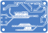
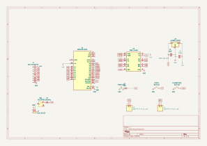

# Arduino Nano PID Line Follower PCB

[](https://www.kicad.org/)
[](https://www.arduino.cc/)
[](#specifications)
[](LICENSE)
[](#hardware-design--assembly-notes)

A custom, competition-ready **autonomous line follower robot mainboard** powered by the **Arduino Nano** and **Toshiba TB6612FNG** dual motor driver. Designed for high-speed robotics competitions, STEM educational kits, and embedded systems learning.

The board features a modular 8-channel analog IR sensor interface, hardware push buttons for calibration and run initiation, power management with reverse polarity protection, and high-current traces for micro metal gearmotors.

---

## 📸 Board Previews

### PCB Layout (Top & Bottom)
<p align="center">
  
  &nbsp;
  
</p>

### Schematic Diagram
<p align="center">
  <a href="Docs/Schematic.pdf">
    
  </a>
  <br>
  <em>(Click to open or download the high-resolution <a href="Docs/Schematic.pdf">Schematic PDF</a>)</em>
</p>

---

## ⚡ Key Specifications

| Parameter | Specification | Details |
| :--- | :--- | :--- |
| **Microcontroller** | Arduino Nano (ATmega328P) | 16 MHz, 32 KB Flash, 2 KB SRAM |
| **Motor Driver** | TB6612FNG Dual H-Bridge Module | 1.2A continuous / 3.2A peak per channel |
| **Sensor Interface** | 10-Pin JST-XH Header | Supports 8 analog IR sensors (A0–A7) + 5V/GND |
| **Operating Voltage** | 7.4V – 8.4V (2S LiPo Pack) | Reverse-polarity protected with SS34 Schottky diode |
| **Logic Regulation** | LM7805 TO-220 Linear Regulator | With aluminum heatsink bracket |
| **Drive Architecture** | 2-Wheel Differential Drive | 2 × 2-Pin JST motor connectors (L1/L2, R1/R2) |
| **User Controls** | 2 × Tactile Push Buttons | Dedicated `START` and `CALIBRATION` inputs |
| **Status Feedback** | 5mm Through-Hole LED | User-programmable indicator on D12 |
| **Power Switch** | SPDT Miniature Slide Switch | Direct mechanical battery disconnect |
| **Board Dimensions** | 70.0 mm × 50.0 mm | Standard 1.6 mm FR-4, 4 × M3 corner mounting holes |

---

## 🗺️ Pinout & Hardware Mapping

### Arduino Nano Pin Assignments

| Arduino Nano Pin | Net Name | Connected To | Function / Description |
| :---: | :---: | :---: | :--- |
| **D2** | `P1` | `START_1` Button | Run / Trigger initiation button (Active LOW) |
| **D3** | `calib` | `CALIBRATION_1` Button | Sensor calibration routine trigger (Active LOW) |
| **D4** | `STBY` | TB6612FNG Pin 13 (`STBY`) | Motor driver standby enable (Active HIGH) |
| **D5** | `PWMA` | TB6612FNG Pin 16 (`PWMA`) | Left motor PWM speed control (Timer0) |
| **D6** | `PWMB` | TB6612FNG Pin 10 (`PWMB`) | Right motor PWM speed control (Timer0) |
| **D7** | `AIN2` | TB6612FNG Pin 15 (`AI2`) | Left motor direction input 2 |
| **D8** | `AIN1` | TB6612FNG Pin 14 (`AI1`) | Left motor direction input 1 |
| **D9** | `BIN1` | TB6612FNG Pin 12 (`BI1`) | Right motor direction input 1 |
| **D10** | `BIN2` | TB6612FNG Pin 11 (`BI2`) | Right motor direction input 2 |
| **D12** | `led` | Status LED (`D2`) | User diagnostic indicator |
| **A0 – A7** | `A0` – `A7` | Sensor Header `J1` (Pins 2–9) | 8-Channel Analog IR sensor readings |
| **5V** | `+5V` | LM7805 Output / VCC Rail | System logic supply |
| **GND** | `GND` | Common Ground Plane | Star ground return |

---

## 📦 Bill of Materials (BOM)

| Ref Des | Qty | Component Value | Package / Footprint | Procurement Link |
| :--- | :---: | :--- | :--- | :--- |
| **U1** | 1 | Arduino Nano V3.0 (CH340/FTDI) | Socket / Module Footprint | [Robu.in Link](https://robu.in/product/arduino-nano-board-r3-ch340-chip-with-usb-cable-solderedarduino-nano-r3-usb-cable/) |
| **U2** | 1 | TB6612FNG Motor Driver Module | SparkFun ROB-14450 Compatible | [Robu.in Link](https://robu.in/product/motor-driver-tb6612fng-module-performance-ultra-small-volume-3-pi-matching-performance-ultra-l298n/) |
| **U3** | 1 | LM7805 Linear Regulator (5V, 1.5A) | TO-220-3 Vertical | [Robu.in Link](https://robu.in/product/l7805cv-stmicroelectronics-linear-voltage-regulator-7805-fixed-positive-10v-to-35v-in-5v-and-1-5a-out-to-220-3/) |
| **D1** | 1 | SS34 Schottky Barrier Diode (3A, 40V) | SMD DO-214AC (SMA) | [Robu.in Link](https://robu.in/product/ss34-slkor-40v-500mv3a-3a-smado-214ac-schottky-diodes-rohs/) |
| **D2** | 1 | Red LED (5mm DIP) | LED_D5.0mm Through-Hole | [Robu.in Link](https://robu.in/product/5mm-red-dip-led-pack-of-50/) |
| **C1, C2** | 2 | 10 µF 25V Electrolytic Capacitor | Radial D5.0mm, P2.00mm | [Robu.in Link](https://robu.in/product/10-uf-25v-through-hole-electrolytic-capacitor-pack-of-40/) |
| **SW1** | 1 | SPDT Miniature Slide Switch | SW_MINI-SPDT | [Robu.in Link](https://robu.in/product/1-month-warranty-255/) |
| **START1, CALIBRATION1** | 2 | 6x6 mm Tactile Push Button | SW_PUSH_6mm Through-Hole | [Robu.in Link](https://robu.in/product/tsd001a06018a-bzcn-6mm-6mm-50ma-round-button-direct-insert-6mm-180gf-12v-plugin-tactile-switches-rohs/) |
| **J1** | 1 | 10-Pin JST-XH Straight Male Header | JST_B10B-XH-A 2.5mm Pitch | [Robu.in Link](https://robu.in/product/b10b-xh-amlfsn-jst-1x10p-10p-xh-tin-10-25%E2%84%8385%E2%84%83-3a-1-2-5mm-brass-direct-insert-pluginp2-5mm-wire-to-board-connector-rohs/) |
| **J2** | 1 | 2-Pin Screw Terminal Block (5.0mm) | XY306A-5.0 2P Blue | [Robu.in Link](https://robu.in/product/xy306a-5-0-xinya-2-pin-screw-terminal-blockblue/) |
| **J3, J4** | 2 | 2-Pin JST-XH/PH Motor Connectors | S2B-PH-K-S / JST 2-Pin 2.54mm | [Robu.in Link](https://robu.in/product/2-pin-jst-xh-2-54mm-pitch-plug-and-socket-with-cable-10-pcs/) |
| **Heatsink** | 1 | Aluminum TO-220 Heatsink | TO220-718 with Screw | [Robu.in Link](https://robu.in/product/to220-718-aluminum-heatsink-for-transistor-pack-of-5/) |

---

## 🧠 PID Line Following Algorithm

The robot uses a **Weighted Average Centroid** algorithm to calculate the position of the line relative to the center of the 8-sensor array:

$$\text{Error} = \frac{\sum_{i=0}^{7} \text{SensorValue}_i \times \text{Weight}_i}{\sum_{i=0}^{7} \text{SensorValue}_i}$$

Where $\text{Weight} = \{-3500, -2500, -1500, -500, 500, 1500, 2500, 3500\}$.

### PID Steering Correction
$$\text{Correction} = (K_p \times \text{Error}) + \left(K_i \times \sum \text{Error}\right) + (K_d \times \Delta\text{Error})$$

* **Left Motor Speed:** $V_{\text{left}} = V_{\text{base}} + \text{Correction}$
* **Right Motor Speed:** $V_{\text{right}} = V_{\text{base}} - \text{Correction}$

If the line is momentarily lost (all sensors off track), the algorithm retains the last known error sign to continue turning back onto the track.

The complete code is located in [`Firmware/LineFollower/LineFollower.ino`](Firmware/LineFollower/LineFollower.ino).

---

## 🛠️ Hardware Design & Assembly Notes

> [!IMPORTANT]
> **Rev 1.0 Bring-Up Instructions:**
> 1. **Arduino Nano 5V Power Pin:** In Rev 1.0, the 5V regulated output is wired to Nano Pin 30 (`VIN`). For optimal operation and to bypass the Nano's onboard regulator dropout, bridge Nano Pin 27 (`5V`) to the board's `+5V` rail.
> 2. **LED Series Resistor:** When assembling Rev 1.0, place a **330 Ω** resistor in series with LED `D2` to protect GPIO pin D12 from overcurrent.
> 3. **Input Voltage Recommendation:** The LM7805 has a ~2.0V dropout voltage. When running on a 2S LiPo (7.4V nominal), consider using an **LM2940CT-5.0** low-dropout regulator (0.5V dropout, pin-compatible TO-220) for full discharge headroom down to 6.0V.
> 4. **Decoupling Capacitors:** In addition to the electrolytic capacitors, solder a 100 nF ceramic capacitor across the motor driver VM-GND to absorb high-frequency PWM switching transients.

---

## 🏭 Manufacturing & Fabrication Files

The board is designed for standard low-cost PCB fabrication (JLCPCB, PCBWay, etc.):

* **Layers:** 2-Layer Board
* **Dimensions:** 70.0 mm × 50.0 mm
* **PCB Thickness:** 1.6 mm
* **Copper Weight:** 1 oz (35 µm)
* **Surface Finish:** HASL (or Lead-free HASL / ENIG)
* **Minimum Trace / Space:** 0.25 mm / 0.25 mm (Power traces 1.0 mm)
* **Gerber Archive:** Ready-to-order Gerber ZIP is available at [`Gerber/lineFollow_Gerbers.zip`](Gerber/lineFollow_Gerbers.zip).

---

## 📂 Repository Structure

```
Arduino-Nano-Line-Follower-PCB/
│
├── Firmware/
│   └── LineFollower/
│       └── LineFollower.ino         # Arduino PID line follower firmware
│
├── Gerber/
│   ├── lineFollow_Gerbers.zip       # Complete fabrication archive (JLCPCB / PCBWay ready)
│   ├── lineFollow.drl               # Excellon drill file
│   ├── lineFollow-F_Cu.gtl          # Top copper layer
│   ├── lineFollow-B_Cu.gbl          # Bottom copper layer
│   ├── lineFollow-F_Silkscreen.gto  # Top silkscreen
│   └── ...                          # Solder masks, paste, edge cuts
│
├── Images/
│   ├── PCB_Top.svg                  # Vector render of top copper and silkscreen
│   ├── PCB_Bottom.svg               # Vector render of bottom copper and ground fill
│   └── Schematic.svg                # Vector circuit schematic diagram
│
├── Docs/
│   ├── Schematic.pdf                # Full printable A4 schematic sheet
│   └── BOM.csv                      # Bill of materials with part numbers & links
│
├── lineFollow.kicad_sch             # KiCad 10 schematic file
├── lineFollow.kicad_pcb             # KiCad 10 board layout
├── lineFollow.kicad_pro             # KiCad project file
├── LINE FOLLOWER PCB.step           # 3D mechanical CAD model (STEP)
├── lineFollow.csv                   # Component procurement links
├── .gitignore                       # Git ignore for EDA cache and backups
└── README.md                        # Project documentation
```

---

## 👨‍💻 Author

**Neil Gibson Pinto**  
*Electronics & Communication Engineering*  
*Specialized in Embedded Systems, Robotics, and Custom Hardware Design.*

---

## 📄 License

This hardware design and source code are released under the [MIT License](LICENSE).
Feel free to use, modify, and build upon this design for academic, competition, and commercial projects.
